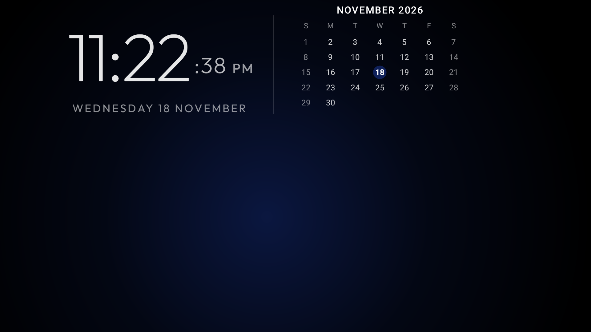

# TV Home (`com.emmanuel.tvhome` v7.0)

A standalone, 100% offline Android TV / Google TV launcher (`minSdk 26`, `targetSdk 34`, **zero `INTERNET` permission**) combining a tvOS-inspired glass Home screen, built-in Quick Settings with Sleep Timer, built-in Notification Center, standalone Wallpaper Manager, interactive Remote Button Mapper, and self-healing key services — tuned for MediaTek Cortex-A55 / Mali TVs (**Haier MatrixTV DE 55"**).

---

## Screenshots

| Home Launcher | Quick Settings |
|---|---|
|  |  |

| Notification Center | Launcher Settings & Button Mapper |
|---|---|
|  |  |

| Month Calendar & Clock Screensaver |
|---|
|  |

---

## Features

- **tvOS-Style Glass Home & Dock**:
  - Configurable 4–7 column grid, frosted dock band (`30%`–`100%` opacity), spring-animated glass focus highlight (`GlassView`), `LastOpened` usage sync, and `AppLibraryDialog` for hidden apps.
  - Async `HeroArt` ambient backdrop blur (`LauncherExecutors.io()`) and `Horizon` ambient brand glow (`240×135` bilinear-filtered textures).
- **Built-in Quick Settings & Sleep Timer** (`QuickSettingsActivity`, `SleepTimer`):
  - Google TV–style translucent side panel (`Screensaver`, `Inputs`, `Display`, `Sound`, `Wi-Fi`, `Bluetooth`, `Sleep timer` stepping `Off → 15 → 30 → 45 → 60 → 90 → 120 min`, `Reorder apps`, and `Notifications`).
- **Built-in Notification Center** (`NotificationPanelActivity`, `GuardRevival`):
  - Standalone `NotificationListenerService` + translucent right-side panel with per-notification open, long-press dismiss, and `Clear all` — zero external add-on APKs required.
- **Standalone Wallpaper Manager** (`LauncherSettingsActivity`, `WallpaperPlayer`):
  - Separate Home and Screensaver wallpaper pickers supporting theme wallpapers, device storage (`Pictures`, `Download`, `Wallpapers`), and `ACTION_GET_CONTENT` image import (up to 15 MB, 100% offline).
- **Interactive Remote Button Mapper & Physical Remote Suite** (`ButtonMapper`, `RemoteKeys`, `HomeKeyService`, `InputKeyService`):
  - Remap any non-navigation remote key (`Red`, `Green`, `Yellow`, `Blue`, `Guide`, `Info`, `Menu`, `Bookmark`, or any key via **Detect Remote Button…**) to `Quick Settings`, `Notifications`, `Recent Apps`, `TV Inputs`, `Rearrange Apps`, `Screensaver / Clock`, `App Library`, `TV Settings`, or any installed app.
  - Built-in `config.xml` remote mappings for Haier / MediaTek Google TV remotes: Settings Gear (`80`, `83` → Quick Settings), Live TV / Guide (`scan:225`, `scan:362`, `172` / `KEYCODE_GUIDE`), YouTube (`297`, `190`), Netflix (`298`, `191`), Prime Video (`299`, `193`), Hotstar (`300`, `194`, `scan:379`), and Play Store (`scan:580`).
  - Merges `config.xml` defaults with optional `config.json` overlays (`Config.mergeIntArray` / `Config.mergeAppKeys`) and mirrors custom Button Mapper rules to `button_mappings.json` (`Config.dir`).
- **Self-Healing Services Across Installs & Reboots** (`ServiceRepair`, `DirectBoot`):
  - Automatically restores `HomeKeyService`, `InputKeyService`, `accessibility_enabled=1`, and `GuardRevival` notification access when `WRITE_SECURE_SETTINGS` is granted.
- **Month Calendar & Clock Screensaver** (`ClockActivity`, `ClockDream`):
  - OLED burn-in–safe 60-second drift layout with digital clock, full date, and interactive month calendar (`Calendar` / `Clock` style, `Wallpaper` / `Glow` / `Black` background).
- **Live System Telemetry** (`MemInfo`, `StatsText`):
  - Optional top-bar RAM & storage readout (`Memory <used> / <total> MB · Storage <free> GB free`) using a zero-allocation `/proc/meminfo` parser.

---

## Hardware Optimization & Resource Benchmark

Tuned for **Haier MatrixTV DE 55" (`HR9676EUF`, MediaTek `mt5896`/`mt5873`, ARM Cortex-A55, Mali `mali.mt5873`, 2 GB DDR, Android 14)** and verified on the Android TV 14 emulator (`emulator-5554`, `cmd package compile -m speed -f com.emmanuel.tvhome`):

| Metric | Value |
|---|---|
| Release APK Size | **`578,865` bytes** (under `589,824` B / 576 KB gate) |
| Unit Tests & Lint | **`48` suites / `343` tests passed** (`0` failures), **`0` lint errors** |
| Total Memory PSS (`dumpsys meminfo`) | **`39,428 KB` (~38.5 MB)** (`0 KB` Swap Dirty) |
| Native / Dalvik Heap Alloc | **`20,107 KB` / `3,274 KB`** |
| Idle CPU (`top -b -n 1`) | **`0.0%` CPU** (`23` threads) |
| Active D-Pad Navigation (`dumpsys gfxinfo`) | **`16 ms` p50 / `17 ms` p90 / `18 ms` p99** (`0.00%` legacy jank, `0` slow UI thread) |

---

## Build, Test & Install

### Build, Unit Tests & Lint

```powershell
cd tv-launcher
.\gradlew.bat --no-daemon testReleaseUnitTest lintRelease assembleRelease
```

Release APK output: `app\build\outputs\apk\release\tvhome-v7.0-release.apk`

### Install to TV over ADB

- **Windows (PowerShell):**
  ```powershell
  .\build-and-install.ps1 -TvHost 192.168.1.50
  ```
- **macOS / Linux:**
  ```bash
  TV_HOST=192.168.1.50 ./build-and-install.sh
  ```

Both scripts automatically build, install, set `com.emmanuel.tvhome/.MainActivity` as default Home, enable `HomeKeyService`, `InputKeyService`, and `GuardRevival`, and grant `WRITE_SECURE_SETTINGS` and `GET_USAGE_STATS`.
