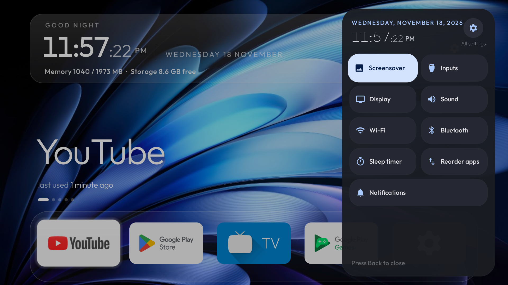
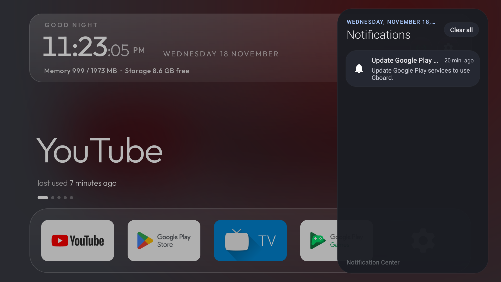
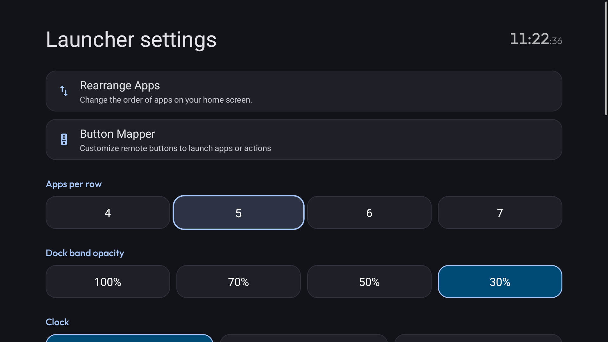

# VYNTRA (`com.emmanuel.tvhome` v7.0)

A standalone, 100% offline Android TV / Google TV launcher (`minSdk 26`, `targetSdk 34`, `versionCode 70`, `versionName 7.0`, **zero `INTERNET` permission**) unifying a tvOS-inspired glass Home screen, built-in Quick Settings with Sleep Timer, built-in Notification Center, standalone Home & Screensaver Wallpaper Manager, interactive Remote Button Mapper, and self-healing key services — tuned specifically for **Haier MatrixTV DE 55"** (`HR9676EUF`, MediaTek Cortex-A55 / Mali).

---

## Screenshots

| Home Launcher | Quick Settings |
|---|---|
|  |  |

| Notification Center | Launcher Settings & Button Mapper |
|---|---|
|  |  |

| Month Calendar & Clock Screensaver |
|---|
|  |

---

## Complete Feature Breakdown

### 1. tvOS-Style Glass Home & Dock (`MainActivity`, `AppAdapter`, `GlassView`)
- **Configurable Grid & Frosted Dock**: Supports 4–7 columns, configurable dock opacity (`30%`–`100%`), concentric dock padding (`DockDecoration`, `DockSlots`), and `Order` persistence.
- **Spring Physics & Ambient Lighting**: Spring-interpolated glass focus highlight (`GlassView` cached in hardware texture layer), `WindowMorph` transitions, `Horizon` ambient brand glow, and async `HeroArt` blurred backdrop (`LauncherExecutors.io()`).
- **App Library & Hidden Apps**: `AppLibraryDialog` manages apps removed from Home without uninstalling.
- **Usage Tracking**: `LastOpened` records app close timestamps on return to Home and syncs with `UsageStatsManager` (`PACKAGE_USAGE_STATS`) at most once per minute on a background priority thread.
- **Top Bar Telemetry & Indicators**: Optional live clock (`LiveClockView`, `ClockFormat`: `System` / `12-hour` / `24-hour`), Wi-Fi status color indicator, Inputs pill (`TvInputRouter`), Settings pill, and live RAM / Storage readout (`MemInfo`, `StatsText`).

### 2. Built-in Quick Settings & Sleep Timer (`QuickSettingsActivity`, `SleepTimer`)
- Translucent Google TV–style right-side drawer opened via the remote **Settings / Gear** button (`80`, `83`, `KEYCODE_SETTINGS`) or top-bar action:
  1. **Screensaver** — Launches `ClockActivity`.
  2. **Inputs** — Opens system input selector (`com.android.tv.action.VIEW_INPUTS`) or built-in Inputs dialog fallback.
  3. **Display** — Opens TV Display Settings.
  4. **Sound** — Opens TV Sound Settings.
  5. **Wi-Fi** — Opens TV Wi-Fi Settings.
  6. **Bluetooth** — Opens TV Bluetooth / Remote pairing.
  7. **Sleep timer** — Steps `Off → 15 → 30 → 45 → 60 → 90 → 120 min → Off`; puts TV to standby via `AccessibilityService.GLOBAL_ACTION_LOCK_SCREEN` (Android 9+).
  8. **Reorder apps** — Enters tile reorder mode on Home.
  9. **Notifications** — Opens the built-in `NotificationPanelActivity` (no external add-on APK required).
  10. **All settings** — Opens Android TV System Settings.

### 3. Built-in Notification Center (`NotificationPanelActivity`, `GuardRevival`)
- Built-in `NotificationListenerService` (`GuardRevival`) with zero external add-ons and zero network permissions.
- Displays notification icon, app name, relative timestamp, title, and body text in a 290dp translucent side panel matching Quick Settings.
- **Remote Controls**: `OK` launches the notification's target app/intent; **Long-Press `OK`** dismisses an individual notification; **`Clear all`** clears the cached list.

### 4. Standalone Wallpaper Manager (`LauncherSettingsActivity`, `WallpaperPlayer`)
- Independent **Home Wallpaper** and **Screensaver Wallpaper** pickers inside `LauncherSettingsActivity`:
  - Scans theme wallpapers, device storage (`Pictures`, `Download`, `Wallpapers`), and custom imported images.
  - Imports any image via `Intent.ACTION_GET_CONTENT` (up to `15 MB`, stored locally in `Config.dir(ctx)`).
  - Supports wallpaper rotation (`WallpaperRotation`), dimming (`wallpaper_dim`), mood filtering (`WallpaperMood`), and `RGB_565` / `ARGB_8888` decoding.

### 5. Interactive Remote Button Mapper & Haier Physical Remote Suite
- **Button Mapper (`ButtonMapper`)** inside **Launcher Settings**:
  - Remap common TV remote keys (`App Switch`, `Red`, `Green`, `Yellow`, `Blue`, `Guide`, `TV Input`, `Bookmark`, `Info`, `Settings`, `Menu`, `Play/Pause`, `Fast Forward`, `Rewind`, `Channel Up/Down`, `Help`) or capture any physical button with **Detect Remote Button…**.
  - Assignable targets: `Quick Settings`, `Notifications`, `Recent Apps`, `TV Inputs`, `Rearrange Apps`, `Screensaver / Clock`, `App Library`, `TV Settings`, or **any installed app** (`LEANBACK_LAUNCHER` / `LAUNCHER`).
  - Navigation, Home, Back, Volume, and Power keys are protected (`isProtectedKey`) so the user can never lock themselves out.
  - Cross-service `ACTION_UP` deduplication (`handleKeyEvent`) across `HomeKeyService`, `InputKeyService`, and `MainActivity`.
  - Automatic external JSON backup (`button_mappings.json` in `Config.dir(ctx)` and `/sdcard/CleanYourTV/button_mappings.json` where storage permits) plus optional `"button_mappings"` restore from `config.json`.
- **Built-in Haier / MediaTek Physical Remote Mappings (`res/values/config.xml` & `RemoteKeys`)**:
  - **Settings / Quick Panel**: `settings_key_keycodes` `80`, `83` (`settings_key_panel=true`, input keys prioritized in `HomeKeyService.isSettingsKey`).
  - **Live TV & EPG Guide**: `scan:225` (`com.mediatek.wwtv.tvcenter` + `input:com.mediatek.dtv.tvinput.dvbtuner/.DvbTvInputService/HW0` fallback), `scan:362` (`com.mediatek.wwtv.tvcenter`), `172` / `KEYCODE_GUIDE` (`com.cltv.hybrid` + `front:*:guide:com.cltv.hybrid`).
  - **App Shortcuts**:
    - YouTube: `297`, `KEYCODE_FEATURED_APP_1`, `190`, `KEYCODE_BUTTON_3` (`com.google.android.youtube.tv`)
    - Netflix: `298`, `KEYCODE_FEATURED_APP_2`, `191`, `KEYCODE_BUTTON_4` (`com.netflix.ninja`)
    - Prime Video: `299`, `KEYCODE_FEATURED_APP_3`, `193`, `KEYCODE_BUTTON_6` (`com.amazon.amazonvideo.livingroom`)
    - Hotstar: `300`, `KEYCODE_FEATURED_APP_4`, `194`, `KEYCODE_BUTTON_7`, `scan:379` (`in.startv.hotstar`)
    - Google Play Store: `scan:580` (`com.android.vending`)
  - **Supported `RemoteKeys` Action Words**: `back`, `home`, `recents`, `mute`, `sleep`, `screensaver`, `settings`, `panel`, `quick_settings`, `notifications`, `wifi`, `library`, `ignore`, plus `input:<id>`, `inputs`, `guide:<pkg>`, `hold:`, `front:`, and `scan:`.

### 6. Self-Healing Services & Config Overlay Merging (`ServiceRepair`, `Config`, `DirectBoot`)
- **Persistent Helpers Across Installs & Force-Stops**: `HomeKeyService` and `InputKeyService` preserve their `ServiceRepair` records across `onUnbind`, and `ServiceRepair.restore(Context)` automatically re-enables both accessibility services (`enabled_accessibility_services`, `accessibility_enabled=1`, 10 s cooldown on unbound recovery) and `GuardRevival` (`enabled_notification_listeners`) whenever `WRITE_SECURE_SETTINGS` is held.
- **Direct Boot Aware**: Both `HomeKeyService` and `InputKeyService` wait safely for `ACTION_USER_UNLOCKED` via `DirectBoot` before loading credential-protected preferences.
- **Non-Destructive Theme Overlays**: `Config.mergeIntArray(...)` and `Config.mergeAppKeys(...)` merge `config.json` overlays with built-in `config.xml` remote mappings instead of overwriting them.

### 7. Month Calendar & Clock Screensaver (`ClockActivity`, `ClockDream`, `ClockScene`)
- Dual digital clock + Month Calendar grid (`Calendar` or `Clock` style) with `Wallpaper`, `Glow`, or `Black` background, 60-second OLED burn-in drift, configurable idle timeout (`home_idle_clock_minutes`), and system `DreamService` (`ClockDream`) support.

---

## Hardware Optimizations & Resource Benchmark

### Target TV Hardware Specs
- **Device**: Haier MatrixTV DE 55" Google TV (`HR9676EUF`, board `omonia`, platform `merak`)
- **OS**: Android 14 (`SDK 34`, build `UKN5.251016.114`)
- **CPU / GPU**: MediaTek `mt5896` / `mt5873` (`mt9603_eu_7`) ARM Cortex-A55 (`aarch32`), ARM Mali (`mali.mt5873`), `ro.sf.lcd_density = 320`, `debug.hwui.render_dirty_regions = false`
- **Memory**: `2048 MB` DDR (`dalvik.vm.heapgrowthlimit = 192m`, `dalvik.vm.heapminfree = 512k`, `dalvik.vm.heapmaxfree = 8m`)

### Optimizations Applied
- **Removed `.withLayer()` FBO Churn** (`AppAdapter.Holder`): Eliminated per-focus offscreen FBO texture allocations during `translationZ` animations.
- **Async `HeroArt` & Sliding-Window Blur** (`HeroArt`, `MainActivity`): Offloaded `HeroArt.from(...)` to `LauncherExecutors.io()`, reused static `PX`/`TEMP` scratch buffers, and replaced the `O(span)` inner blur loop with an `O(1)` sliding window.
- **240×135 Ambient & Scrim Bitmaps + Primitive Animator** (`MainActivity`): Reduced `scrimDrawable()` and `setAmbient()` bitmaps by 75% with `setFilterBitmap(true)`, skipped redundant tint invalidations via `lastAmbientTint`, and replaced `ArgbEvaluator` object boxing with primitive `ValueAnimator.ofFloat(0f, 1f)`.
- **Zero-Allocation `/proc/meminfo` Parser** (`MemInfo`, `MainActivity`): Replaced regex `.split("\\s+")` in `MemInfo.kb(String)` with a digit scanner and stopped reading `/proc/meminfo` as soon as `MemTotal:` and `MemAvailable:` are parsed.
- **APK Size & Font Optimization**: Restored trimmed `83,876`-byte `outfit.ttf`, R8 obfuscation/shrinking (`Log.d`/`Log.i` stripped), `aapt2 optimize --deduplicate-entry-values`, Zopfli recompression, and v2-only APK signing.

### Observed Benchmark (`emulator-5554`, `cmd package compile -m speed -f com.emmanuel.tvhome`)

| Metric | Before Optimization | After Optimization |
|---|---|---|
| Release APK Size | `587,057` bytes | **`578,865` bytes** (`10,959` B under `589,824` B gate) |
| Unit Tests & Lint | `48` suites / `343` tests | **`48` suites / `343` tests passed, `0` lint errors** |
| Active Navigation Frames (`gfxinfo`) | `48` frames | **`90` frames** |
| Janky Frames / Legacy Jank | `37 (77.08%)` / `47 (97.92%)` | **`1 (1.11%)` / `0 (0.00%)`** |
| Frame Time (50th / 90th / 95th / 99th) | `93 / 150 / 150 / 150 ms` | **`16 / 17 / 17 / 18 ms`** |
| GPU Frame Time (50th / 90th / 99th) | `4950 / 4950 / 4950 ms` | **`13 / 15 / 16 ms`** |
| Slow UI Thread / Missed Vsync / Bitmap Uploads | `30 / 26 / 1` | **`0 / 0 / 0`** |
| Total Memory PSS (`meminfo`) | `45,439 KB` (`2` activities, `231` views) | **`39,428 KB`** (`1` activity on Home, `145` views) |
| Native / Dalvik Heap Alloc | `24,430 KB` / `3,629 KB` | **`20,107 KB` / `3,274 KB`** (`0 KB` Swap Dirty) |
| `.ttf mmap` PSS / `Code` PSS | `407 KB` / `3,776 KB` | **`169 KB` / `2,100 KB`** |
| Idle CPU / Threads | `0.0%` / `24` | **`0.0%` / `23`** |

---

## Permissions & Privacy

- **Zero `INTERNET` permission** — 100% offline, zero analytics, zero telemetry, zero background polling.
- Declared permissions in `AndroidManifest.xml`:
  - `ACCESS_NETWORK_STATE`, `ACCESS_WIFI_STATE`, `ACCESS_FINE_LOCATION` (Wi-Fi SSID pill indicator)
  - `WRITE_SECURE_SETTINGS` (granted via ADB by installer scripts so `ServiceRepair` restores key helpers)
  - `PACKAGE_USAGE_STATS` (app-op granted via ADB for `LastOpened` timestamps)
  - `BLUETOOTH_CONNECT`, `yandex.tv.permission.ACCESS_TV_SOURCE` (TV input/Bluetooth integration)
  - Signature-protected `${applicationId}.permission.WALLPAPER_SYNC` (local-only)

---

## Build, Test & Install

### Build, Unit Tests & Lint

```powershell
.\gradlew.bat --no-daemon testReleaseUnitTest lintRelease assembleRelease
```

Release APK output: `app\build\outputs\apk\release\tvhome-v7.0-release.apk`

### Install to TV over ADB

- **Windows (PowerShell):**
  ```powershell
  .\build-and-install.ps1 -TvHost 192.168.1.50
  ```
- **macOS / Linux:**
  ```bash
  TV_HOST=192.168.1.50 ./build-and-install.sh
  ```

Both installer scripts build the release APK, install it over ADB, set `com.emmanuel.tvhome/.MainActivity` as the default Home activity, and enable `InputKeyService`, `HomeKeyService`, `WRITE_SECURE_SETTINGS`, `GET_USAGE_STATS`, and `GuardRevival` by default.

---

## Project Layout

```text
VYNTRA/
├── app/
│   ├── build.gradle              # R8/ProGuard, aapt2 resource optimization, Zopfli + v2-only APK gate
│   ├── lint.xml                  # Zero-error Android Lint policy
│   ├── proguard-rules.pro        # R8 obfuscation + strips Log.d/Log.i in release
│   └── src/
│       ├── main/                 # com.emmanuel.tvhome Java sources, layouts, drawables, config.xml
│       └── test/                 # 48 JVM unit test suites (343 tests)
├── docs/screenshots/             # Live screenshots (home, quick-settings, notifications, settings, screensaver)
├── build-and-install.ps1         # Windows ADB installer (defaults helpers & permissions ON)
├── build-and-install.sh          # POSIX ADB installer (defaults helpers & permissions ON)
├── FONT-LICENSE-OFL.txt          # Outfit font license
└── ICONS-LICENSE-FLUENT-EMOJI.txt
```

---

## Credits & Inspiration

Inspired by and originally built upon [Gathin23/cleanyourtv](https://github.com/Gathin23/cleanyourtv).

