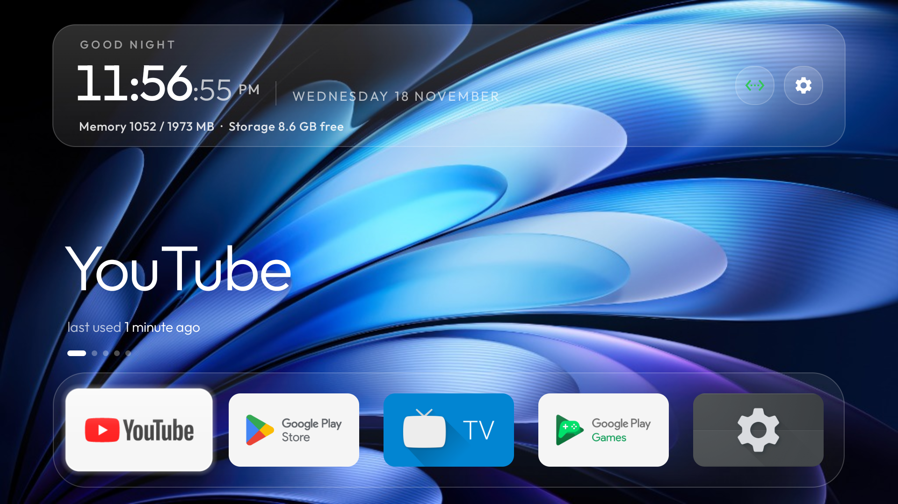

# VYNTRA TV Launcher

VYNTRA is an offline home screen for Android TV and Google TV. Pin apps to a dock, switch inputs and open Quick Settings with the remote. The launcher was developed on a 55-inch Haier MatrixTV DE running Android 14 and supports Android API 26 or newer.

[Build from source](#build-from-source) · [Screenshots](#screenshots) · [Performance](#performance) · [v7.2 release notes](https://github.com/emmanuel11003/VYNTRA-TV-launcher/releases/tag/v7.2)



## Using the launcher

| Task | How it works |
| --- | --- |
| Arrange apps | Hold **OK** on a tile to move it, add it to the dock or hide it from Home. Hidden apps remain available in the App Library. |
| Open TV controls | Quick Settings brings inputs, Wi-Fi, Bluetooth and the sleep timer into one panel. The timer ranges from 15 minutes to two hours. |
| Assign a remote button | In **Launcher Settings → Button Mapper**, press a supported key and choose an app or action. Home, Back, Power and Volume are reserved. |
| Read notifications | Open the Notification Center, select a notification to follow it or hold **OK** to dismiss it. This feature uses Android notification access. |
| Change the idle screen | Choose a clock or calendar and set a wallpaper. The optional [Wallpaper Sync companion](addons/wallpaper-sync/README.md) accepts images from a phone on the same Wi-Fi network. |

## Build from source

Install JDK 17, Android SDK Platform 34 and Build Tools 34.0.0. Set `ANDROID_HOME` to your SDK directory, or set `sdk.dir` in a local `local.properties` file. Run the following from the repository root to build the launcher and run its unit tests and lint checks.

**Windows PowerShell**

```powershell
.\gradlew.bat --no-daemon testReleaseUnitTest lintRelease assembleRelease
```

**macOS or Linux**

```sh
sh gradlew --no-daemon testReleaseUnitTest lintRelease assembleRelease
```

The optimized v7.2 APK is written to `app/build/outputs/apk/release/tvhome-v7.2-release.apk`. The [Gradle configuration](app/build.gradle) defines the package, SDK requirements, signing configuration and APK size limit.

### Try it on a TV

With Android SDK Platform Tools installed and your TV connected to an authorized ADB session, run these commands from the repository root. The final command opens VYNTRA so you can try the interface before choosing a default home screen.

```sh
adb devices
adb install -r app/build/outputs/apk/release/tvhome-v7.2-release.apk
adb shell am start -n com.emmanuel.tvhome/.MainActivity
```

The bundled [PowerShell](build-and-install.ps1) and [shell](build-and-install.sh) installers automate additional steps, including changing the default Home app. They expect a sibling CleanYourTV `tools/` directory outside this checkout. Button mapping and notification features may need additional permissions on the TV.

### Add wallpaper uploads

Build both apps with the same signing key so the companion can use the launcher's wallpaper provider. From the repository root, run the command for your platform.

| Platform | Build command |
| --- | --- |
| Windows PowerShell | `.\gradlew.bat -p addons/wallpaper-sync assembleRelease` |
| macOS or Linux | `sh gradlew -p addons/wallpaper-sync assembleRelease` |

```sh
adb install -r addons/wallpaper-sync/app/build/outputs/apk/release/wallpapersync-v1.0-release.apk
```

Open **Launcher Settings → Wallpaper → Sync from Phone** and scan the QR code. Enter the PIN shown on the TV to upload a Home or screensaver image. The [core launcher](app/src/main/AndroidManifest.xml) runs without Android’s `INTERNET` permission. The [companion](addons/wallpaper-sync/app/src/main/AndroidManifest.xml) requests it to serve the upload page over local Wi-Fi.

## Screenshots

| Quick Settings and sleep timer | Notification Center |
| --- | --- |
|  |  |

[Button Mapper](docs/screenshots/launcher-settings.png) · [Clock and calendar](docs/screenshots/screensaver.png) · [App tile menu](docs/screenshots/tile-menu.png) · [Wallpaper Sync](docs/screenshots/wallpaper-sync.png)

## Performance

The project recorded the following results for v7.2. Frame timing and memory were sampled on an Android emulator. The Haier TV was the development device.

| Measurement | Recorded result |
| --- | ---: |
| Launcher APK, including the default wallpaper | 689,531 bytes |
| Wallpaper Sync APK | 37,236 bytes |
| Launcher unit tests | 343 passed across 48 suites |
| Launcher lint errors | 0 |
| Navigation frame time, median / 99th percentile | 16 ms / 18 ms |
| Janky frames in the navigation sample | 1 of 90 |
| Home screen memory, total PSS | 39,428 KB |

The [release notes](https://github.com/emmanuel11003/VYNTRA-TV-launcher/releases/tag/v7.2) describe the navigation changes. The Gradle build enforces APK size limits of 720,896 bytes for the [launcher](app/build.gradle) and 40,960 bytes for the [companion](addons/wallpaper-sync/app/build.gradle).

## Source guide

The [v7.2 engineering notes](docs/engineering.md) describe the rendering changes, service lifecycle, remote mappings and before-and-after measurements.

| Start here | What to look for |
| --- | --- |
| [RemoteKeys](app/src/main/java/com/emmanuel/tvhome/RemoteKeys.java) and [ButtonMapper](app/src/main/java/com/emmanuel/tvhome/ButtonMapper.java) | How a physical key becomes a launcher action or app shortcut |
| [ClockScene](app/src/main/java/com/emmanuel/tvhome/ClockScene.java) | Clock layout, wallpaper and movement while the TV is idle |
| [WallpaperBridgeProvider](app/src/main/java/com/emmanuel/tvhome/WallpaperBridgeProvider.java) | How the separately installed companion passes an image to the launcher |
| [JVM tests](app/src/test) | Test cases for launcher behaviour and configuration |

## Credits and license

VYNTRA builds on [Gathin’s CleanYourTV launcher](https://github.com/Gathin23/cleanyourtv). The launcher is released under the [MIT License](LICENSE). The bundled [Outfit typeface](FONT-LICENSE-OFL.txt) and [Fluent Emoji icons](ICONS-LICENSE-FLUENT-EMOJI.txt) retain their respective license notices.
